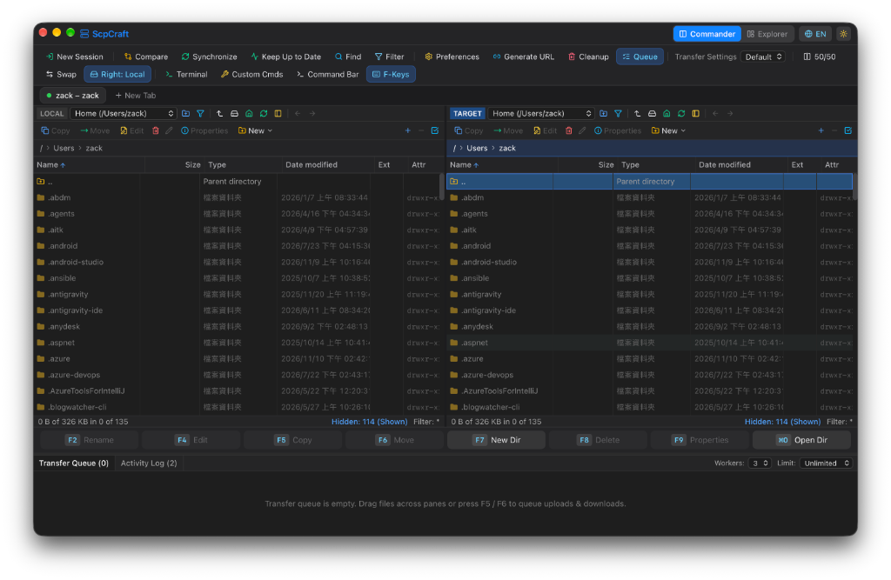

# ScpCraft

**English** | [繁體中文](README_zhTW.md)

**ScpCraft** is a native cross-platform dual-pane file manager and multi-protocol transfer client built with **Tauri 2.0** (Rust + React / TypeScript).

It provides a fast, keyboard-friendly Commander / Explorer workflow with native platform polish across **macOS** (Universal Apple Silicon + Intel), **Windows**, and **Linux**.



---

## Key Features

- **Multi-Protocol Support**
  - **SFTP / SCP**: Powered by pure-Rust `russh` & `russh-sftp` with SSH key inspection (OpenSSH & PPK), interactive keyboard authentication, host key verification, and SSH jump-host tunneling.
  - **FTP / FTPS**: Active/Passive (`PASV`/`EPSV`), `MLSD` and Unix/DOS `LIST` parsing.
  - **Amazon S3 / S3-Compatible (MinIO, HiCloud S3, etc.)**: Pure-Rust AWS SigV4 signing over `rustls` TLS (`https://` / port `443`) and HTTP.
  - **WebDAV**: `PROPFIND` directory browsing and CRUD over HTTP/HTTPS (`rustls`).
- **Dual-Pane Commander & Explorer Modes**
  - Switch seamlessly between side-by-side **Commander** mode and single-pane **Explorer** mode.
  - Multi-tab sessions with per-tab right-pane state isolation (local workspaces, SFTP, S3, FTP, WebDAV).
  - Virtualized file lists (`@tanstack/react-virtual`), breadcrumbs, directory tree sidebar, wildcard filtering, and drag-and-drop transfers.
- **Adaptive Platform UI**
  - **macOS**: Native overlay titlebar (`titleBarStyle: "Overlay"`), Retina/HiDPI support (`NSHighResolutionCapable`), `SF Pro` / `PingFang TC` typography, Safari/Finder-style rounded tabs, and `⌘` shortcut badges.
  - **Windows / Linux**: Classic dense Commander toolbar, menu bar, and `F2`–`F9` function-key action bar.
- **Transfer Queue & Sync Tools**
  - Concurrent transfer queue with pause, resume, cancel, retry, bandwidth throttling, and overwrite conflict resolution.
  - Bidirectional directory comparison & synchronization, **Keep Up to Date** watcher, remote file search, integrated external/internal editor watch, and interactive SSH terminal drawer.
- **Security & Configuration**
  - Passwords, key passphrases, and tunnel credentials are stored in the **OS native keyring** (macOS Keychain, Windows Credential Manager, Linux Secret Service) — never in plaintext JSON.
  - **Password-free YAML (`.yml`) Import & Export** (`scpcraft-sites.yml`) for backing up and sharing site profiles safely.
- **Bilingual & Themed**
  - Built-in **Traditional Chinese (繁體中文)** and **English** UI switching, plus **Dark** and **Light** themes.

---

## Tech Stack

- **Backend**: Rust, Tauri 2, Tokio, `russh` / `russh-sftp`, `rustls` / `tokio-rustls` / `webpki-roots`, `keyring`, `serde_yaml`
- **Frontend**: React 19, TypeScript, Vite, Tailwind CSS v4, Zustand, `@tanstack/react-virtual`, `lucide-react`

---

## Getting Started (Development)

### Prerequisites

- **Node.js** `22+` and **pnpm** `10+`
- **Rust** (stable toolchain via `rustup`)
- Platform build dependencies:
  - **macOS**: Xcode Command Line Tools (`xcode-select --install`)
  - **Linux (Ubuntu/Debian)**: `libwebkit2gtk-4.1-dev libappindicator3-dev librsvg2-dev patchelf libsecret-1-dev`
  - **Windows**: Microsoft Visual Studio C++ Build Tools & WebView2

### Install & Run

```bash
# Install frontend dependencies
pnpm install

# Start Tauri development app (Vite + Rust)
pnpm tauri dev
```

### Test & Build

```bash
# Run Rust unit tests
cargo test --manifest-path src-tauri/Cargo.toml

# TypeScript check + Vite production bundle
pnpm build

# Build native installer / bundle for the current OS
pnpm tauri build

# Build macOS Universal DMG (Apple Silicon + Intel)
rustup target add aarch64-apple-darwin x86_64-apple-darwin
pnpm tauri build --target universal-apple-darwin --bundles dmg
```

---

## Platform Installation Notes (Unsigned Development Builds)

Until signed with a commercial Code Signing / Apple Developer certificate:

- **macOS**: If Gatekeeper blocks opening the app, drag `ScpCraft.app` into `/Applications` and run:
  ```bash
  xattr -cr /Applications/ScpCraft.app
  ```
  *(Or go to **System Settings → Privacy & Security → Open Anyway**.)*
- **Windows**: If Microsoft Defender SmartScreen prompts *"Windows protected your PC"*, click **More info → Run anyway**.

---

## Project Structure

```text
ScpCraft/
├── src/                        # React + TypeScript frontend
│   ├── components/             # Layout, FilePane, SiteManager, Transfer, Sync, Editor, Terminal
│   ├── hooks/                  # Keyboard navigation & drag-and-drop transfer hooks
│   ├── i18n/                   # zh-TW / en translations
│   ├── services/               # Tauri IPC wrappers
│   ├── stores/                 # Zustand workspace & site stores
│   └── utils/                  # Formatters & platform detection
├── src-tauri/                  # Rust backend & Tauri configuration
│   ├── capabilities/           # Tauri v2 capability permissions
│   ├── icons/                  # Application icons
│   ├── src/
│   │   ├── config/             # Site repository (keyring) & YAML import/export
│   │   ├── protocols/          # FTP/FTPS, S3 (SigV4 + rustls), WebDAV
│   │   ├── sftp/               # SSH/SFTP session, ops, PPK, PTY shell
│   │   ├── sync/               # Directory diff & Keep-Up-to-Date watcher
│   │   └── transfer/           # Multi-worker transfer queue & resume rules
│   ├── Info.plist              # macOS HiDPI & graphics switching metadata
│   ├── tauri.conf.json         # Base Tauri config
│   └── tauri.macos.conf.json   # macOS overlay titlebar & window sizing
├── CHANGELOG.md                # Release history
├── LICENSE                     # Apache License 2.0
└── NOTICE                      # Attribution & clean-room notice
```

---

## License

Licensed under the **Apache License, Version 2.0**. See [LICENSE](LICENSE) and [NOTICE](NOTICE) for details.
