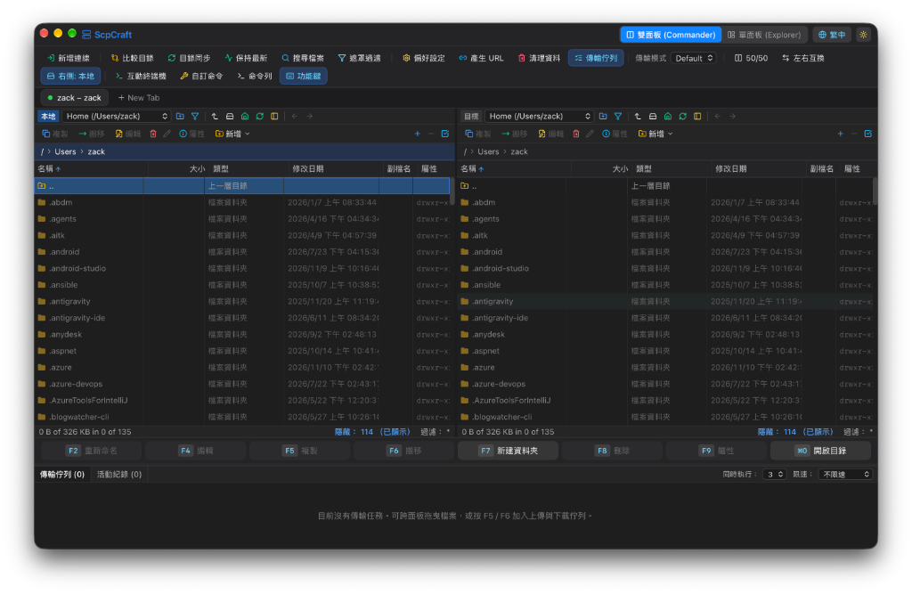

# ScpCraft

[English](README.md) | **繁體中文**

**ScpCraft** 是一款使用 **Tauri 2.0**（Rust + React / TypeScript）打造的跨平台雙面板檔案管理與多協定傳輸工具。

提供流暢且支援鍵盤快速鍵的 Commander（雙面板）／Explorer（單面板）操作體驗，並針對 **macOS**（Universal Apple Silicon + Intel）、**Windows** 與 **Linux** 提供原生平台介面優化。



---

## 核心功能

- **多協定支援**
  - **SFTP / SCP**：採用純 Rust `russh` 與 `russh-sftp`，支援 OpenSSH / PPK 金鑰檢視、互動式鍵盤驗證、Host Key 信任驗證與 SSH 跳板機（Tunnel）。
  - **FTP / FTPS**：支援主動／被動模式（`PASV` / `EPSV`）、`MLSD` 與 Unix / DOS `LIST` 目錄解析。
  - **Amazon S3 / S3 相容儲存（MinIO、HiCloud S3 等）**：純 Rust AWS SigV4 簽章搭配 `rustls` TLS（支援 `https://` / port `443`）與 HTTP。
  - **WebDAV**：透過 HTTP / HTTPS（`rustls`）進行 `PROPFIND` 目錄瀏覽與檔案讀寫管理。
- **雙面板 Commander 與單面板 Explorer 模式**
  - 可隨時切換左右雙面板 **Commander** 模式或單面板 **Explorer** 模式。
  - 支援多分頁連線，每個分頁獨立保存與還原右側面板狀態（本機工作區、SFTP、S3、FTP、WebDAV）。
  - 虛擬化高效檔案列表（`@tanstack/react-virtual`）、麵包屑路徑列、目錄樹側邊欄、萬用字元篩選與拖放傳輸。
- **跨平台自適應 UI**
  - **macOS**：原生覆蓋式標題列（`titleBarStyle: "Overlay"`）、Retina / HiDPI 支援（`NSHighResolutionCapable`）、`SF Pro` / `蘋方繁中`字體排印、圓角分頁標籤與 `⌘` 快速鍵提示。
  - **Windows / Linux**：經典高密度工具列、功能選單列與底部 `F2`–`F9` 快速鍵列。
- **傳輸佇列與目錄同步**
  - 多工作緒平行傳輸佇列，支援暫停、繼續、取消、重試、頻寬限速與覆寫衝突處理。
  - 雙向目錄比對與同步、**Keep Up to Date** 即時監控同步、遠端檔案搜尋、內建／外部編輯器監控儲存，以及互動式 SSH 終端機抽屜。
- **安全性與設定檔管理**
  - 密碼、金鑰密語與跳板機密碼皆透過**作業系統原生鑰匙圈**儲存（macOS Keychain、Windows Credential Manager、Linux Secret Service），絕不以明文寫入 JSON。
  - **無密碼 YAML（`.yml`）匯入與匯出**（`scpcraft-sites.yml`），安全備份與分享站台設定，不包含任何密碼或金鑰。
- **雙語系與主題**
  - 內建 **繁體中文** 與 **English** 介面即時切換，以及 **深色（Dark）**／**淺色（Light）** 主題。

---

## 技術架構

- **後端**：Rust、Tauri 2、Tokio、`russh` / `russh-sftp`、`rustls` / `tokio-rustls` / `webpki-roots`、`keyring`、`serde_yaml`
- **前端**：React 19、TypeScript、Vite、Tailwind CSS v4、Zustand、`@tanstack/react-virtual`、`lucide-react`

---

## 開發與建置

### 環境需求

- **Node.js** `22+` 與 **pnpm** `10+`
- **Rust**（透過 `rustup` 安裝 stable 工具鏈）
- 各平台系統相依套件：
  - **macOS**：Xcode Command Line Tools（`xcode-select --install`）
  - **Linux (Ubuntu/Debian)**：`libwebkit2gtk-4.1-dev libappindicator3-dev librsvg2-dev patchelf libsecret-1-dev`
  - **Windows**：Microsoft Visual Studio C++ Build Tools 與 WebView2

### 安裝與啟動開發模式

```bash
# 安裝前端相依套件
pnpm install

# 啟動 Tauri 開發視窗（Vite + Rust）
pnpm tauri dev
```

### 測試與打包

```bash
# 執行 Rust 單元測試
cargo test --manifest-path src-tauri/Cargo.toml

# TypeScript 型別檢查與 Vite 正式建置
pnpm build

# 打包目前作業系統的安裝檔
pnpm tauri build

# 打包 macOS Universal DMG（Apple Silicon + Intel）
rustup target add aarch64-apple-darwin x86_64-apple-darwin
pnpm tauri build --target universal-apple-darwin --bundles dmg
```

---

## 未簽章版本安裝說明

在尚未套用商業程式碼簽章或 Apple Developer 憑證公證前：

- **macOS**：若開啟時被 Gatekeeper 阻擋，請將 `ScpCraft.app` 拖入 `/Applications` 後於終端機執行：
  ```bash
  xattr -cr /Applications/ScpCraft.app
  ```
  *（或至「系統設定 → 隱私權與安全性」最下方點擊「仍要打開」。）*
- **Windows**：若 Microsoft Defender SmartScreen 顯示「Windows 已保護您的電腦」，請點擊 **「其他資訊」→「仍要執行」**。

---

## 專案結構

```text
ScpCraft/
├── src/                        # React + TypeScript 前端
│   ├── components/             # Layout、FilePane、SiteManager、Transfer、Sync、Editor、Terminal
│   ├── hooks/                  # 鍵盤導覽與拖放傳輸 Hooks
│   ├── i18n/                   # 繁體中文 / 英文語系檔
│   ├── services/               # Tauri IPC 呼叫封裝
│   ├── stores/                 # Zustand 工作區與站台狀態管理
│   └── utils/                  # 格式化工具與平台偵測
├── src-tauri/                  # Rust 後端與 Tauri 設定
│   ├── capabilities/           # Tauri v2 視窗與權限設定
│   ├── icons/                  # 應用程式圖示
│   ├── src/
│   │   ├── config/             # 站台設定儲存庫（Keyring）與 YAML 匯入／匯出
│   │   ├── protocols/          # FTP/FTPS、S3（SigV4 + rustls）、WebDAV
│   │   ├── sftp/               # SSH/SFTP 連線、操作、PPK、PTY 終端機
│   │   ├── sync/               # 目錄比對與 Keep-Up-to-Date 監控
│   │   └── transfer/           # 多工作緒傳輸佇列與續傳規則
│   ├── Info.plist              # macOS HiDPI 與顯示卡切換設定
│   ├── tauri.conf.json         # 基礎 Tauri 設定
│   └── tauri.macos.conf.json   # macOS 標題列樣式與預設視窗尺寸
├── CHANGELOG.md                # 版本更新紀錄
├── LICENSE                     # Apache License 2.0
└── NOTICE                      # 版權與獨立實作聲明
```

---

## 授權條款

本專案採用 **Apache License, Version 2.0** 授權，詳見 [LICENSE](LICENSE) 與 [NOTICE](NOTICE)。
